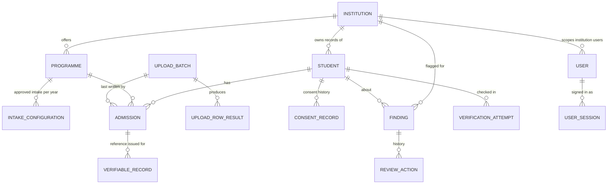

# Data model

Defined in `backend/app/models`, created by the Alembic migration in
`backend/alembic/versions/0001_initial_schema.py`. All primary keys are UUIDs; all timestamps are
stored in UTC. JSON columns use `JSONB` on PostgreSQL.

## Entities

| Table | Purpose | Key constraints |
|---|---|---|
| `institutions` | Approved institutions (synthetic) | unique `code` |
| `programmes` | Programmes offered by an institution | unique (`institution_id`, `code`) |
| `intake_configurations` | Approved intake and supernumerary seats per programme and academic year, with `source` and notes | unique (`programme_id`, `academic_year`); checks ≥ 0 |
| `users` | Platform accounts; institution users carry `institution_id` | unique `email`; `role` check constraint |
| `user_sessions` | Server-side sessions; only a SHA-256 of the cookie token is stored, plus the CSRF token | unique `token_hash` |
| `students` | A person **as recorded by one institution** | unique (`institution_id`, `institution_student_id`); unique (`institution_id`, `apaar_fingerprint`) |
| `admissions` | One admission of a student to a programme in an academic year; NRI / OCI / FN flags, seat type, enrolment status | unique (`student_id`, `programme_id`, `academic_year`); index (`institution_id`, `academic_year`, `enrolment_status`) |
| `consent_records` | Append-only consent history; the latest row per student and purpose is current | — |
| `upload_batches` | One CSV submission: counts, file-level errors, warnings, checksum, repeat detection, timing | index on `file_sha256` |
| `upload_row_results` | Outcome per row with error codes; label is the institution student ID — never the APAAR ID or row payload | unique (`batch_id`, `row_number`) |
| `findings` | Explainable validation flags with evidence, restricted (central-only) evidence, status, dedupe key, evidence signature | indexes for queue and dedupe |
| `review_actions` | Append-only review history (human or system) | — |
| `verification_attempts` | Every verification request: kind, purpose, provider, `simulated`, outcome, safe details | — |
| `verifiable_records` | Record references issued for admissions, with a keyed integrity digest | unique `reference_code` |
| `audit_events` | Append-only audit trail with safe metadata only | indexes on `action`, `created_at` |
| `system_settings` | Configurable policy values (JSON) | primary key `key` |

## Identity versus admission

- `students` is institution-owned. The same person at two institutions has two student rows
  that share an `apaar_fingerprint`. That is how cross-institution duplicates are detected
  **without** merging records across tenants or letting one institution read another's data.
- `admissions` separates enrolment from identity, so a student can have several admissions
  over time (re-admission, a second programme) without becoming a new person.

## How APAAR identifiers are stored

| Column | Content | Used for |
|---|---|---|
| `apaar_fingerprint` | HMAC-SHA256(key, normalised ID) | Uniqueness, matching, lookups |
| `apaar_ciphertext` | Fernet encryption of the normalised ID | Printing on the audited record view; simulated identity check |
| `apaar_last4` | Last four characters | Masked display (`••••••••0123`) |

The raw identifier is never stored in plaintext, never written to logs or audit events, and
never placed in a URL. Keys come from the environment (see [security-model.md](security-model.md)).

## Data handling

- Raw upload files are **not** retained — only a checksum, counts and row results.
- Reported metrics are computed from these tables at request time; there are no hard-coded figures.
- Retention and deletion rules are an open question (see assumptions document).
